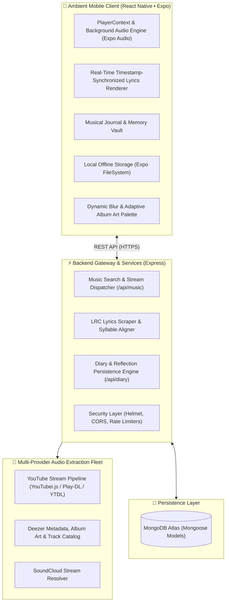

# Lpiks Bloom — Ambient Audio Streaming, Synchronized Lyrics & Musical Diary Platform

<p align="center">
  
  
  
  
  
  
</p>

---

## Executive Summary

**Lpiks Bloom** is an ambient, cross-platform music streaming ecosystem and personal audio journaling platform built with **React Native (Expo)** and a high-performance **Node.js/Express** microservice backend.

Designed to transcend conventional commercial music players, Lpiks Bloom integrates a multi-provider audio aggregation pipeline (YouTube, Deezer, and SoundCloud) that extracts high-bitrate audio streams on-the-fly without third-party subscription paywalls. It pairs high-fidelity background playback with **sub-second synchronized LRC lyrics**, **offline track caching**, and an intimate **Musical Diary** allowing listeners to chronicle reflections, emotional states, and milestones anchored to specific tracks.

---

## System Architecture



---

## Core Technical Highlights

### 1. Multi-Provider Audio Streaming & Fallback Hierarchy
* **Dynamic Stream Resolution:** Queries catalog metadata across Deezer and YouTube, extracting clean, high-bitrate Opus and AAC audio streams on demand via `youtubei.js`, `play-dl`, and custom resolvers.
* **Failover Redundancy:** If an audio stream source drops or rate-limits, the backend automatically fails over to alternate provider manifests without disrupting user playback.

### 2. Sub-Second Synchronized Lyrics Engine
* **Precision LRC Ingestion:** Fetches, parses, and formats time-stamped `.lrc` and syllable-level lyric manifests (`lyricService.js`).
* **Active Line Tracking:** Automatically calculates playback offsets, highlighting and auto-scrolling lyrics synchronously with millisecond accuracy as the audio progresses.

### 3. Musical Diary & Emotional State Journaling
* **Track-Anchored Journaling:** Allows users to log written thoughts, dates, and emotional tags tied to individual songs (`models/Diary.js`).
* **Sovereign Reflection Archive:** Users can revisit life milestones through their listening history, reviewing what they felt and thought during specific musical moments.

### 4. Ambient UI & Audio Performance
* **Adaptive Glassmorphic Canvas:** Utilizes `expo-blur` and `expo-linear-gradient` to extract dominant chromatic palettes from album art, dynamically casting rich, diffused ambient glows across the player viewport.
* **Continuous Background Audio:** Fully configured for background playback with lock-screen media notification controls via `expo-audio`.
* **Offline Resiliency:** Implements local audio caching using `expo-file-system` to enable offline listening on previously cached favorites.

---

## Project Structure

```text
Music-stream/
├── client/                      # React Native / Expo Mobile Application
│   ├── src/
│   │   ├── components/          # Reusable audio controls, sliders, lyric sheets
│   │   ├── context/             # PlayerContext, global audio playback state
│   │   ├── navigation/          # Bottom tabs and stack navigators
│   │   ├── screens/             # HomeScreen, PlayerScreen, LibraryScreen, DiaryScreen
│   │   ├── services/            # Client-side API connectors
│   │   └── utils/               # lyricService.js, audio helpers
│   ├── app.json                 # Expo native bundle configuration
│   └── package.json             # Mobile client dependencies
│
├── server/                      # Node.js & Express Audio Gateway
│   ├── models/                  # Mongoose Schemas (Diary, Track, Playlist)
│   ├── src/
│   │   ├── routes/              # Express API routers (music.js, diary.js)
│   │   ├── services/            # Deezer, YouTube, and lyrics extractors
│   │   └── app.js               # Express application entrypoint
│   └── package.json             # Backend dependencies
│
└── README.md                    # System architecture & documentation
```

---

## Quickstart & Local Setup

### Prerequisites
* **Node.js** >= 18.0.0
* **MongoDB** connection URI (Local or MongoDB Atlas)
* **Expo CLI** (`npx expo`)

### 1. Backend Server Setup
```bash
cd server
npm install

# Configure environment variables
# Set PORT, MONGODB_URI in server/.env
npm start
# Server boots on configured port (e.g. http://localhost:5000)
```

### 2. Mobile Client Setup
```bash
cd ../client
npm install

# Launch Expo development server
npx expo start

# Run on physical device or emulator
npm run android   # Android device / emulator
npm run ios       # iOS device / simulator
```

---

## Author & Engineering Credits

Architected and developed by **Abdelhadi Hammaz** ([@Lpiks](https://github.com/Lpiks))  
*Senior Full-Stack & Systems Engineer • Co-founder, Stepping Stones Agency*

Distributed under the **ISC License**.
